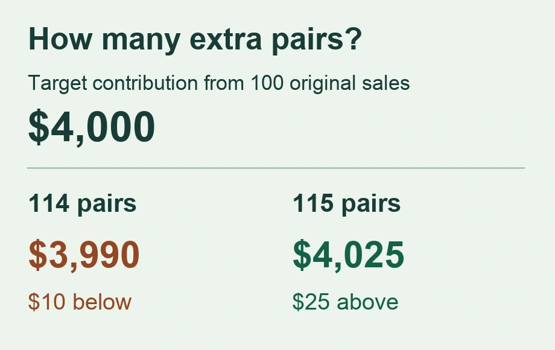

**The store can pay Affirm even when the shopper pays no interest.** At an integrated merchant, Affirm generally earns a fee when a purchase goes through. The rate depends on the merchant’s agreement and financing terms. Affirm says it generally earns a larger merchant fee on a 0% APR offer than on an interest-bearing one. [Affirm’s FY2026 annual report, Item 7](https://www.sec.gov/Archives/edgar/data/1820953/000162828026059279/afrm-20260630.htm)

## Follow a $100 pair of shoes

Say you buy shoes for $100 and choose four equal payments at 0% APR. Assume the store has agreed to a **$5 merchant fee**. That fee is hypothetical and chosen for easy arithmetic. Leave sales tax, returns and any other merchant charges out of the example.

| Whose money? | What happens              |           Amount |
| ------------ | ------------------------- | ---------------: |
| Shopper      | Four payments of $25      |       $100 total |
| Store        | $100 sale less a $5 fee   | $95 net proceeds |
| Affirm       | Merchant fee before costs |               $5 |
| Shopper      | Interest over the plan    |               $0 |

The store receives its settlement without waiting for you to finish paying. Over the plan, your four payments repay the purchase price. Adding those payments to the fee would count the return of loan principal as income. The fee comes out of the store’s side of this sale. The shopper’s receipt still adds up to $100.

## Why would a store give up $5?

Consider a retailer whose shoes cost it $60. A $100 sale leaves $40 before payment fees and other expenses. In our example, the $5 fee brings that figure to $35. If installment payments helped win an order the retailer would otherwise have lost, that $35 helps cover the store’s other costs. If a shopper would have bought anyway, the merchant compares what it keeps under each available payment method.

How many extra sales would justify the fee? Suppose the store normally sells 100 pairs at full price. At $40 each after the cost of the shoes, those sales contribute $4,000. If every buyer switches to the financing offer, the store keeps $35 per pair. It needs to sell **115 pairs** to reach its original dollar contribution. At 114 pairs it earns $3,990. One more pair takes it to $4,025.

This example assumes the original payment method cost the merchant nothing and every order has the same margin. A retailer with its own numbers can replace $40 with what it actually keeps after existing payment charges. If only some customers switch, it can run the calculation on those sales alone.

That trade-off helps explain why financing terms vary. A store promoting a costly item over a longer term may value the offer differently from a store selling a $100 pair of shoes. The actual agreement determines what Affirm collects on either order. [Affirm’s annual report, merchant network revenue discussion](https://www.sec.gov/Archives/edgar/data/1820953/000162828026059279/afrm-20260630.htm)

## How the fee shows up in Affirm’s accounts

The integrated store’s fee contributes to **merchant network revenue**. Across its entire business, Affirm reported approximately **$1.15 billion** in that category for the year ended June 30, 2026. Merchant network revenue was **2.3% of gross merchandise volume** for the year. That percentage combines different merchants, products and channels. Applying it to the shoes would give you a portfolio average where you need the store’s contract. [Affirm’s audited revenue note](https://www.sec.gov/Archives/edgar/data/1820953/000162828026059279/R10.htm) and [FY2026 management discussion](https://www.sec.gov/Archives/edgar/data/1820953/000162828026059279/afrm-20260630.htm)

Affirm also earns card network revenue on eligible card transactions and interest income on interest-bearing loans it holds. It can earn fees for servicing loans owned by investors. Each line answers a different question. For a closer look at the card-network side of a payment, see [how Visa makes money](/companies/how-visa-makes-money/).

## How much of the $5 does Affirm keep?

The receipt alone cannot tell you. Someone has to fund the balance while the shopper repays, process the payments and absorb losses if borrowers fail to repay. Who bears each cost depends in part on who holds the loan. Affirm’s accounts show funding costs and provisions for credit losses separately from its revenue. It also discloses that buying a below-market-rate loan from a bank partner can create an accounting loss when the purchase price exceeds the loan’s fair value. [Affirm’s annual report, loan purchases and credit losses](https://www.sec.gov/Archives/edgar/data/1820953/000162828026059279/afrm-20260630.htm)

For this checkout, the known amounts are $100 of purchase volume, a hypothetical $5 merchant fee and $0 of shopper interest. To evaluate Affirm as a business, follow the fee into revenue and the lending costs into expenses. Stocker’s guide to [revenue versus earnings](/learn/revenue-vs-earnings/) explains how to read those two figures together.
