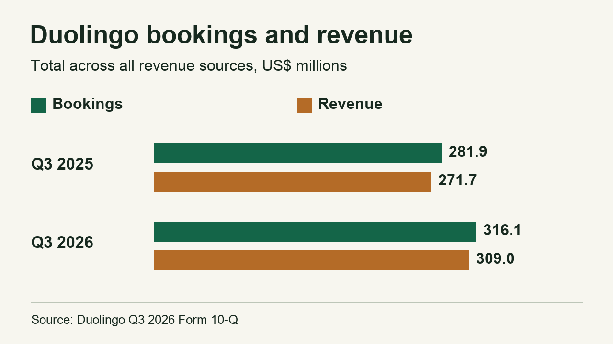

Duolingo can offer its courses for free because paid subscriptions fund most of the business. In the quarter ended September 30, 2026, subscribers generated **$270.0 million of Duolingo’s $309.0 million revenue**, about 87%. Advertising brought in another $20.8 million. English tests and purchases inside the app accounted for most of the rest. [Duolingo’s quarterly revenue table](https://www.sec.gov/Archives/edgar/data/1562088/000162828026069692/R24.htm)

## Where the money comes from

| Revenue source        |     Q3 2025 |     Q3 2026 |
| --------------------- | ----------: | ----------: |
| Subscriptions         |     $229.5m |     $270.0m |
| Advertising           |      $21.0m |      $20.8m |
| Duolingo English Test |       $9.6m |       $9.9m |
| In-app purchases      |      $11.1m |       $6.9m |
| Other                 |       $0.5m |       $1.5m |
| **Total**             | **$271.7m** | **$309.0m** |

Rounded to the nearest $0.1 million. The English Test earns a fee from people who need evidence of English proficiency. In-app purchases cover virtual goods bought separately from a subscription. In Q3, subscription revenue rose by about $40.5 million, enough to cover a $4.2 million drop in in-app purchases and still drive growth. [Duolingo Q3 2026 Form 10-Q](https://www.sec.gov/Archives/edgar/data/1562088/000162828026069692/duol-20260930.htm)

## What a free learner contributes

Someone practicing on the free tier can generate ad impressions today and become a subscriber later. Those are two different ways to earn money from the same learner over time. They also respond to different things. Longer practice habits can create more opportunities to show an ad. An ad-free experience and extra learning features give a learner reasons to pay.

The distinction shows up in the numbers. Duolingo averaged 64.9 million daily active users in Q3 2026, up 29% year over year, while ad revenue edged down. Ending paid subscriptions rose 14% to 13.1 million. Dividing that count by active users would mix a point-in-time subscriber count with an average activity measure. It would also miss family members who use paid features under someone else’s subscription. Measuring conversion requires following the same group of free learners over time. [Duolingo’s quarterly operating metrics](https://www.sec.gov/Archives/edgar/data/1562088/000162828026069692/duol-20260930.htm)

## When a booking becomes revenue

Imagine a learner buys a $120 annual subscription on October 1. In this simplified example, Duolingo records a $120 subscription booking at purchase. By December 31 it has delivered three months of access and recognized about $30 of revenue. The remaining $90 sits in deferred revenue until Duolingo delivers the rest of the subscription.

That timing explains why two numbers appear in every earnings release. Q3 2026 subscription bookings totaled $278.4 million, while subscription revenue reached $270.0 million. The revenue figure includes access delivered to people who bought subscriptions in earlier quarters. Total bookings also include advertising, English tests and virtual goods. Adding bookings to revenue would count some of the same business twice. [Duolingo’s bookings definition and revenue policy](https://www.sec.gov/Archives/edgar/data/1562088/000162828026069692/duol-20260930.htm)

## How to read the next quarter

Look at paid subscribers and subscription bookings together. More people can be paying while the amount collected per purchase changes with plan mix, pricing or renewals. Next, check the deferred revenue note. Of the $496.2 million deferred at the start of 2026, Duolingo had recognized $453.8 million by September 30. That reveals how much earlier business reached the income statement during the year. [Duolingo’s deferred revenue roll-forward](https://www.sec.gov/Archives/edgar/data/1562088/000162828026069692/R24.htm)

[Download the Duolingo bookings and revenue CSV](/downloads/duolingo-bookings-revenue.csv) for the three and nine months ended September 30 in both years. Values are in thousands of US dollars. Each row links to the filing. For another subscription business with a free tier, see [Spotify’s Premium and Ad-Supported revenue breakdown](/companies/spotify-premium-vs-ad-supported-revenue/).
