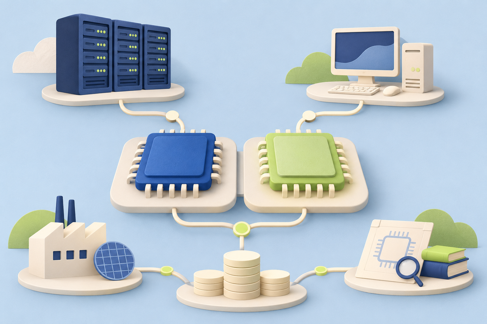

## Where Nvidia’s revenue comes from

When a cloud provider buys Nvidia processors and networking equipment for an AI cluster, Nvidia earns money on the sale. The cloud provider can then earn its own revenue renting computing time to developers. On the gaming side, a laptop maker can buy a GeForce GPU to power the graphics in a computer it sells to a player.

The two businesses operate at very different scales. In the quarter ended October 25, 2026, **about 93 cents of every dollar Nvidia earned in sales came from Data Center**. Here is the breakdown from its [fiscal 2027 third-quarter results](https://investor.nvidia.com/news/press-release-details/2026/NVIDIA-Announces-Financial-Results-for-Third-Quarter-Fiscal-2027/default.aspx).

| Market | Quarterly revenue | Share of sales |
| --- | ---: | ---: |
| Data Center | $107.6 billion | 92.9% |
| Edge Computing, including gaming | $8.2 billion | 7.1% |
| **Total** | **$115.8 billion** | **100%** |

The percentages use Nvidia’s rounded revenue figures. Edge Computing includes GeForce products, local AI computers and automotive technology. Nvidia reported one figure for that group, so this release doesn’t tell us how much gaming earned on its own.

## What a data center buys

A cloud provider needs processors to run AI models and a fast network so those processors can work together. Nvidia can sell both as parts of a rack-scale system. During the quarter it began shipping Vera Rubin NVL72 systems, and Google Cloud and Oracle began offering customers access to infrastructure built with them.

Data Center revenue grew 21% from the previous quarter and 110% from a year earlier. One question for the next filing is how much demand for new systems turns into delivered sales as customers bring power, cooling and network capacity online.

## Why a gaming purchase looks different

A player choosing a GeForce-equipped PC is paying for the whole computer. Nvidia supplies graphics technology, the manufacturer assembles the machine, and a retailer may handle the final sale. The retail price therefore tells you little about Nvidia’s revenue on that purchase. The same distinction applies to cars sold with Nvidia computing hardware.

## What to check next quarter

Look at Data Center revenue and companywide gross margin together. In fiscal Q3, Data Center sales grew 21% sequentially while GAAP gross margin edged down from 75.0% to 74.8%. The two figures answer different questions. Sales show how much customers bought. Gross margin shows how much of each sales dollar remained after the cost of revenue across the whole company.

Compare [Nvidia and AMD](/compare/nvidia-vs-amd/) for differences in their product mix, or see how Nvidia’s sales connect to Microsoft’s infrastructure spending in the [2027 stock watchlist](/companies/best-stocks-for-2027/). The [stock research worksheet](/tools/research-template/) gives you a place to record the quarter and compare it with the next release.
