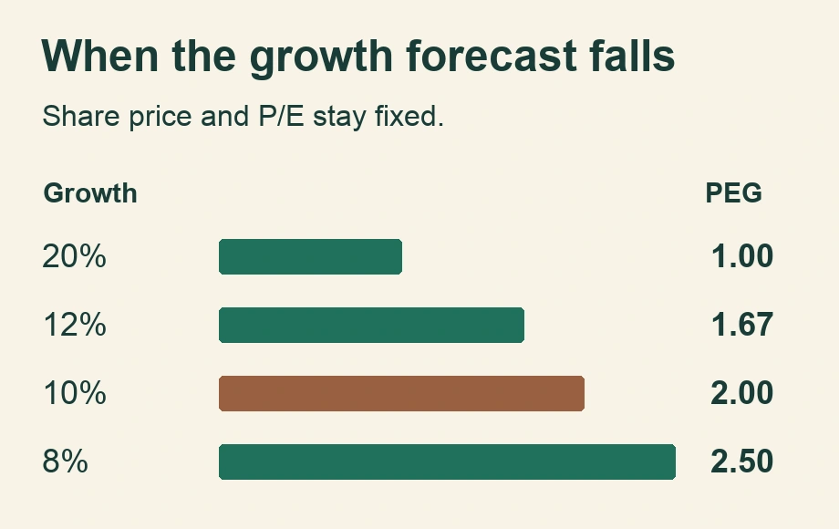

To calculate the **price/earnings-to-growth ratio**, divide a stock’s P/E by its expected annual earnings-per-share growth rate, expressed as a whole percentage number. A stock trading at 20 times earnings with projected EPS growth of 10% has a PEG of **20 ÷ 10 = 2**. At 20% growth, that same multiple gives a PEG of **1**. [Fidelity’s valuation guide](https://www.fidelity.com/learning-center/trading-investing/fundamental-analysis/company-valuation-ratios)

## Start with two stocks at the same price

Imagine two equipment makers, A and B. Both trade at $60 a share. Each earned $3 per diluted share over the past twelve months, so each has a trailing P/E of 20. An analyst expects A’s earnings per share to grow 10% annually over the next three years and B’s to grow 20%. Here is the whole comparison.

| Input or result            |  Stock A |  Stock B |
| -------------------------- | -------: | -------: |
| Share price                |      $60 |      $60 |
| Trailing diluted EPS       |    $3.00 |    $3.00 |
| Trailing P/E               |       20 |       20 |
| Forecast annual EPS growth |      10% |      20% |
| PEG calculation            |  20 ÷ 10 |  20 ÷ 20 |
| **PEG**                    | **2.00** | **1.00** |

Both buyers pay $20 for each dollar of last year’s earnings. B gets the lower PEG entirely because the analyst expects its earnings to compound faster. In this example, B has to lift EPS from $3 to roughly $5.18 in three years to deliver on that forecast. A needs about $3.99. Those targets give you something concrete to check against future earnings reports.

## Convert a multiyear estimate into an annual rate

Sometimes a forecast gives you an ending EPS target instead of annual growth. Divide ending EPS by starting EPS, raise the result to the power of one divided by the number of years, then subtract one. With A’s rounded figures, **($3.99 ÷ $3.00)^(1/3) − 1 ≈ 10%**. The total increase over three years is about 33%. Putting 33 into the PEG formula would make the stock look much cheaper by mixing up the periods.

Check the earnings basis too. A provider may calculate PEG using a forward P/E. To reproduce its figure, use its forecast earnings period, growth horizon and reported or adjusted EPS basis. For a peer comparison, use the same convention on both sides. [Trailing vs. forward P/E](/learn/trailing-vs-forward-pe/)

## Change one estimate before drawing a conclusion

Suppose B’s largest customer delays an order and the analyst cuts expected annual EPS growth from 20% to 8%. At the original $60 price and $3 trailing EPS, B’s PEG rises to **20 ÷ 8 = 2.50**. A now has the lower ratio. Neither stock needed to move a cent for their ranking to reverse.

Where exactly do the rankings switch? At a P/E of 20, B needs 10% expected growth to match A’s PEG of 2. At 12% growth, B’s PEG is about 1.67. A two-point cut to 10% erases its lead. Another two-point cut to 8% puts it behind. You can use that break-even growth rate as a question for the next earnings call. Does management’s outlook still support growth above 10%?

The same calculation works backwards if the share price changes. Suppose B rises to $72 while trailing EPS stays at $3. Its new P/E is 24. Divide 24 by A’s PEG of 2 and you get **12%**. B now needs that much annual EPS growth just to match A on this measure.

For B, ask how much of the expected growth comes from sales already contracted and how much depends on winning new orders. For A, ask whether a weak comparison year or buybacks made its EPS growth easier to achieve. Two forecasts can cover the same period and still carry very different risks. A PEG of 1 by itself tells you little about the likelihood that a forecast will hold. [Schwab’s guide to PEG risks](https://www.schwab.com/learn/story/what-is-peg-ratio-basics-formula-and-risks)

## Try the worksheet with your own pair

[Download the editable PEG ratio worksheet (.xlsx)](/downloads/peg-ratio-worksheet.xlsx). It opens with A and B side by side. Enter the share price, EPS and annual growth for each stock in the blue input cells. Type growth as **10%** in the worksheet. Its formula handles the conversion to 10. To reproduce the stress test, change B’s growth cell to 8%.

Use positive earnings and positive projected growth for this comparison. EPS of zero prevents a P/E calculation, and zero growth prevents a PEG calculation. Losses or shrinking earnings can produce a deceptively low or negative result. The worksheet flags those cases. For a business still losing money, start with [what a negative P/E ratio tells you](/learn/negative-pe-ratio/).
