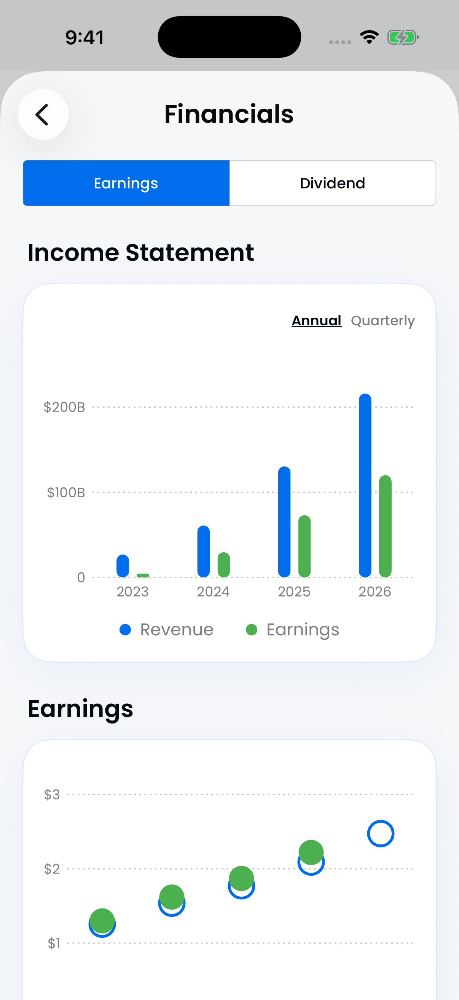

## Start with the business

Before looking for a target price, explain what the company does in one ordinary sentence. Name its customers and the product or service they pay for. If the explanation depends on phrases you cannot define, those phrases are your first research questions.

A stock represents ownership in a business. A familiar logo, a rising chart and a popular product can make that business interesting, but none tells you what its shares are worth.

Use the company's investor-relations website and most recent annual report to establish the basics. The business description, financial statements and risk factors answer different questions. Read them together rather than treating one number as a verdict.

## Build an evidence trail

For each important observation, record three things: the original source, its date and the period it describes. A quarterly result, a trailing twelve-month figure and a forecast for next year are not interchangeable.

A useful first pass looks like this:

| Question                        | Evidence to find                             | What to avoid                                 |
| ------------------------------- | -------------------------------------------- | --------------------------------------------- |
| Who pays the company?           | Business description and customer discussion | Assuming every product is equally important   |
| Is the business growing?        | Comparable revenue periods                   | Comparing a quarter with a full year          |
| Does growth produce profit?     | Earnings, margins and explanations           | Reading sales growth as profit growth         |
| What could interrupt the story? | Risk factors and material changes            | Listing only reasons to be optimistic         |
| What is reflected in the price? | Valuation measures with consistent periods   | Treating a low share price as cheap valuation |

_Use company financials to frame questions, then check the original filings. Stocker screenshot with historical example data._

## Worked example: find Costco’s revenue in a 10-K

Open Costco’s fiscal 2026 10-K. In **Item 8, Financial Statements and Supplementary Data**, look for the **Consolidated Statements of Income**. Use the column for the 52 weeks ended **August 30, 2026**. The statement reports dollars in millions.

| Worksheet field    | What to record                                                                                                                            |
| ------------------ | ----------------------------------------------------------------------------------------------------------------------------------------- |
| Company and period | Costco Wholesale (COST), fiscal 2026, 52 weeks ended August 30                                                                            |
| Net sales          | $297,247 million                                                                                                                          |
| Membership fees    | $5,907 million                                                                                                                            |
| Total revenue      | $303,154 million, the sum of the two lines                                                                                                |
| What to check next | Read Item 7 to understand how sign-ups and fee increases affected the membership line. Check renewal rates in the next comparable filing. |

Try the [free research worksheet](/tools/research-template/) with a company you already follow. Save the filing URL, the period and your next question. Use the same units and reporting period when comparing figures.

## Read the numbers in context

The SEC's financial-statement guide explains how income statements, balance sheets and cash-flow statements connect. Use it to learn the vocabulary, then return to the company's own reporting. A summary in an app is a convenient doorway into that research, not the complete filing.

Start with [revenue and earnings](/learn/revenue-vs-earnings/). If you use a P/E ratio, check whether the earnings are historical or estimated. A [negative P/E](/learn/negative-pe-ratio/) requires a different interpretation from a small positive multiple.

If you’re researching a dividend-paying stock, use the [dividend yield calculator](/tools/dividend-yield-calculator/) to compare its annual dividend per share with its current share price.

Consider the business model when comparing companies. An equipment maker and a subscription software business may share a sector while having very different economics.

## Write down the case against your idea

Try a short counterargument: “My current view would be weaker if…” Then identify the observation that would test it. This makes it easier to recognize new evidence instead of collecting only supporting headlines.

Separate what management forecasts from what has already happened. Forecasts are useful inputs to research, but they remain uncertain. Look for incentives and assumptions behind them.

## Keep a research list

A [watchlist](/learn/stock-watchlist/) gives you a place to revisit interesting companies without buying them. In Stocker, you can discover a company, inspect its profile and financial information, and save it for another look.

For an example, see the [2027 stock research shortlist](/companies/best-stocks-for-2027/). It pairs each company with a source filing, a research question and a risk to investigate.

Use our [free research worksheet](/tools/research-template/) to record questions and sources outside the app. The useful outcome of this first pass may be a clearer question—or a decision that you do not yet understand the company well enough. Neither requires a trade.
