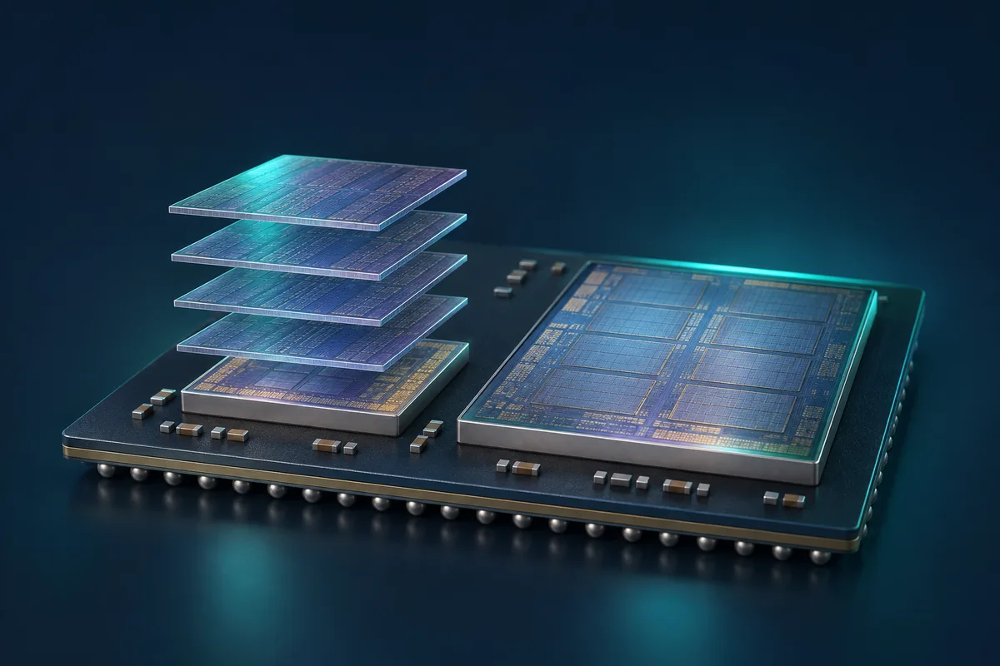
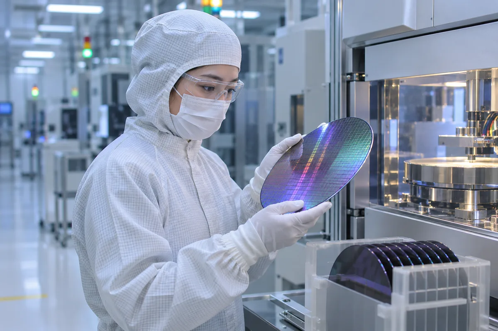

## Three memory chip stocks to research

Micron, SK hynix, and Samsung Electronics are three companies to research for a 2027 memory chip stock watchlist. All three make high-bandwidth memory (HBM), a type of DRAM used in AI accelerators. Their filings give you different ways to track that business.

| Company                 | Primary common shares   | What to track                                 |
| ----------------------- | ----------------------- | --------------------------------------------- |
| **Micron**              | MU · Nasdaq             | Cloud Memory revenue and margin               |
| **SK hynix**            | 000660 · Korea Exchange | HBM4 shipments and server DRAM demand         |
| **Samsung Electronics** | 005930 · Korea Exchange | HBM4 sales and Device Solutions profitability |

Start with the [2027 AI stock watchlist](/companies/ai-stocks-2027/) to see how memory suppliers fit alongside chip designers and cloud providers.

## What HBM stocks give you exposure to

**High-bandwidth memory** stacks layers of DRAM and connects them to a nearby processor through a wide interface. That helps an AI accelerator move data quickly. **Conventional DRAM** also serves as working memory, including in servers, phones, and PCs. **NAND flash** keeps data when power is off and is used in solid-state drives. HBM belongs to the DRAM family. [Micron’s HBM technology guide](https://www.micron.com/products/memory/hbm)

That distinction matters when reading earnings. A memory maker can benefit from selling more HBM while NAND or conventional DRAM prices move in a different direction. The [Nvidia business-model guide](/companies/how-nvidia-makes-money/) explains the other side of the supply chain, where chip designers sell the systems that use this memory.

_Illustration of stacked DRAM sitting alongside a processor in the same package._

## Micron (MU) · Follow Cloud Memory revenue and margins

Micron reports separate Cloud Memory and Core Data Center business units. In its fiscal fourth quarter ended September 3, 2026, it reported **$16.3 billion in Cloud Memory revenue** and an **83% Cloud Memory gross margin**. Those figures cover the whole business unit. For the next report, check whether the unit’s revenue and margin move together, then see how management explains the roles of pricing, shipments, and product mix. [Micron’s fiscal Q4 2026 results](https://investors.micron.com/news/press-release/2026/Micron-Technology-Inc--Reports-Record-Fiscal-Fourth-Quarter-and-Full-Year-2026-Results/)

## SK hynix (000660) · Watch the HBM4 ramp

SK hynix said HBM4 shipments picked up in Q3 2026 while server DDR5 sales also increased. The company expected HBM4 to overtake HBM3E in both shipment volume and revenue in Q4. Use the next report to check whether that transition happened and what the company says about new production capacity. [SK hynix’s Q3 2026 results](https://news.skhynix.com/en/q3-2026-business-results/)

## Samsung Electronics (005930) · Look inside Device Solutions

Samsung reported that it increased HBM4 sales in Q3 2026. Its Device Solutions division includes memory, foundry, and System LSI, so the division’s profit reflects more than memory alone. Use management’s comments on memory to identify what changed in HBM and server SSDs before drawing a conclusion from the division’s headline number. [Samsung’s Q3 2026 results](https://news.samsung.com/global/samsung-electronics-announces-third-quarter-2026-results)

_Expanding memory output can require investment in fabrication and advanced packaging._

## How to compare memory stocks in 2027

1. **Record the metric and period.** Micron’s fiscal quarter ends on a different date from the Korean companies’ calendar quarters. Use the [fiscal year guide](/learn/fiscal-year-vs-calendar-year/) to line up reporting periods.
2. **Separate shipments from plans.** A sample, customer qualification, production ramp, and recognized sale are different milestones. Record the stage the company actually disclosed.
3. **Compare margins with cash spending.** Higher chip prices can lift margins while new fabrication and packaging capacity absorbs cash. Use the [free cash flow guide](/learn/how-to-calculate-free-cash-flow/) to follow both.
4. **Check what the stock price assumes.** Ask how the earnings picture would change if more supply came online or customers placed fewer orders. Compare the business case with the broader [2027 stocks research guide](/companies/best-stocks-for-2027/).

Pick one figure and one question for each company. The [stock research worksheet](/tools/research-template/) gives you a place to record both before the next earnings release.
