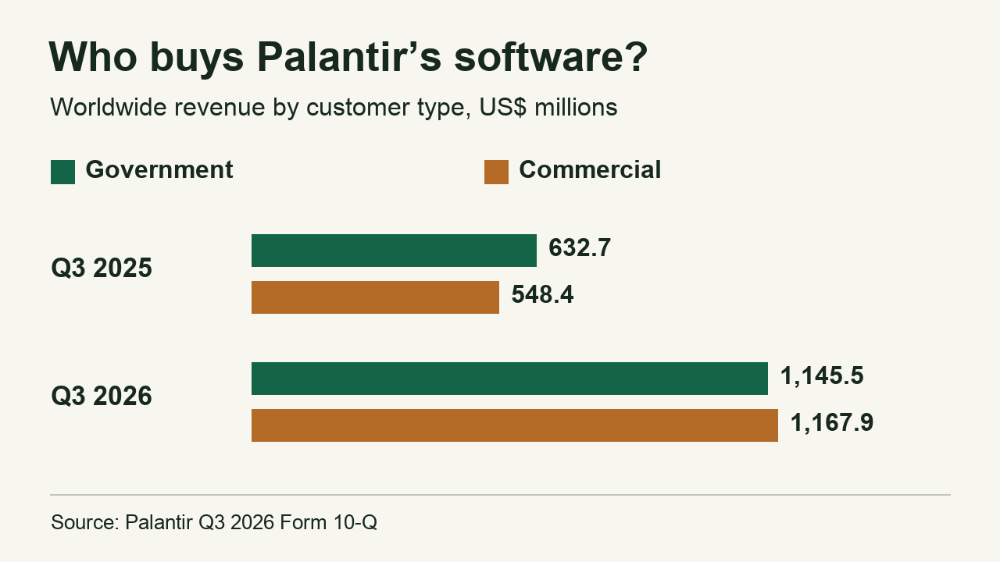

Palantir earned **$1.168 billion from commercial customers and $1.146 billion from government customers in Q3 2026**. Commercial led by just $22.3 million worldwide. Widen the window to the first nine months of 2026 and government still led by $106.5 million. Both comparisons are correct. They describe different stretches of a fast-changing business. [Palantir’s Q3 2026 Form 10-Q](https://www.sec.gov/Archives/edgar/data/1321655/000132165526000048/pltr-20260930.htm)

## Palantir revenue by customer type

| Period                 | Government | Commercial | Commercial share |
| ---------------------- | ---------: | ---------: | ---------------: |
| FY 2023                |    $1,222m |    $1,003m |            45.1% |
| FY 2024                |    $1,570m |    $1,296m |            45.2% |
| FY 2025                |    $2,402m |    $2,073m |            46.3% |
| January–September 2026 |    $2,994m |    $2,887m |            49.1% |
| Q3 2026 alone          |    $1,146m |    $1,168m |            50.5% |

Shares use unrounded worldwide segment revenue. The January–September row includes Q3. Each annual row covers twelve months. The segment identifies who pays Palantir for its platforms and services, so a chart of these two categories cannot tell you how much revenue comes from an individual product such as AIP. [Palantir’s annual segment figures](https://www.sec.gov/Archives/edgar/data/1321655/000132165526000011/pltr-20251231.htm) and [quarterly segment figures](https://www.sec.gov/Archives/edgar/data/1321655/000132165526000048/pltr-20260930.htm)

## How commercial sales caught up

One year earlier, government was about $84 million ahead in the September quarter. Over the following year, quarterly government revenue rose by $513 million, or 81%. Commercial revenue rose by $619 million, or 113%. That extra $107 million of growth, calculated from the unrounded figures, was enough to move commercial into the lead. Government became a smaller share of the total even as its sales rose sharply. [Palantir’s Q3 revenue analysis](https://www.sec.gov/Archives/edgar/data/1321655/000132165526000048/pltr-20260930.htm)

Existing accounts explain much of the change. Customers already on Palantir’s books at the end of 2025 accounted for $484 million of the government increase and $407 million of the commercial increase. A rising customer count alone would miss the money customers spent as they expanded their use of Palantir. [Palantir’s management discussion](https://www.sec.gov/Archives/edgar/data/1321655/000132165526000048/pltr-20260930.htm)

## Where US government and US commercial fit

US government sales were $953 million in Q3 2026. That is a subset of the $1.146 billion worldwide government total. US commercial sales of $984 million likewise sit inside worldwide commercial revenue of $1.168 billion. Adding all four figures would count the US business twice. [Palantir’s geographic disclosures](https://www.sec.gov/Archives/edgar/data/1321655/000132165526000048/pltr-20260930.htm)

The distinction matters when reading a growth headline. US commercial revenue rose **148%**, while worldwide commercial revenue grew **113%**. Use the worldwide number to compare the commercial business against the government segment. Use the US figure when investigating how quickly customers in that market are adopting the software.

## Why a contract announcement can look much larger than sales

Palantir generally recognizes revenue over the life of a contract. A five-year award with a stated ceiling can involve future orders, options or funding decisions. The headline therefore gives little guidance on the amount Palantir can recognize in the next quarter. For government deals in particular, check which portion is funded and whether the agency can end the contract early. [Palantir’s contract terms and risk disclosures](https://www.sec.gov/Archives/edgar/data/1321655/000132165526000048/pltr-20260930.htm)

A practical way to track a large award is to record its announced value and period separately, then check the customer segment in subsequent filings for growth. Palantir reports aggregated segment revenue, so the change in that total alone cannot establish how much an individual deal contributed. The [revenue backlog guide](/learn/revenue-backlog/) explains how funding and cancellation terms affect that comparison.

[Download the Palantir government and commercial revenue CSV](/downloads/palantir-customer-revenue.csv) for three fiscal years and comparable three- and nine-month periods. The file preserves the filings’ precision in thousands of US dollars and includes the source URL for each row.
