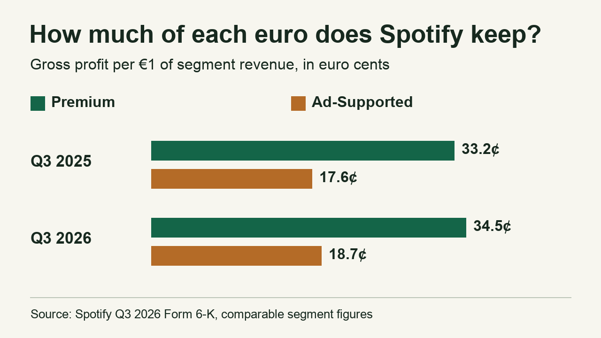

For every €100 Spotify earned in Q3 2026, about **€90 came from Premium**. Premium accounted for an even larger share of gross profit, about €95 per €100. The difference comes down to what each business keeps after paying for content, delivery and other costs of revenue. [Spotify’s Q3 2026 segment results](https://www.sec.gov/Archives/edgar/data/1639920/000162828026066889/spot-20260930x6xk.htm)

## Spotify revenue and gross profit by segment

| Q3 2026, € millions | Premium | Ad-Supported | Spotify total |
| ------------------- | ------: | -----------: | ------------: |
| Revenue             |   4,487 |          482 |         4,969 |
| Cost of revenue     |   2,938 |          392 |         3,330 |
| Gross profit        |   1,549 |           90 |         1,639 |
| Gross margin        |   34.5% |        18.7% |         33.0% |

Gross margin divides each segment’s gross profit by its own revenue. For Premium, €1,549 million divided by €4,487 million gives 34.5%. To calculate Premium’s share of **company gross profit**, change the denominator to €1,639 million. That produces 94.5%. Spotify then pays group operating expenses from that gross profit. Operating income for the quarter was €672 million. [Spotify’s Q3 shareholder update](https://www.sec.gov/Archives/edgar/data/1639920/000114036126040435/ef20084028_ex99-1.htm)

## What Premium earns from a subscriber

A recurring subscription gives Spotify revenue even if one listener streams considerably less than another in a given month. Price changes, the countries subscribers live in, and the plans they buy affect average revenue per subscriber. Spotify attributed the quarter’s 17% rise in Premium revenue to both subscriber growth and higher average revenue per user. It ended September with 306 million Premium subscribers. [Spotify’s Q3 results](https://www.sec.gov/Archives/edgar/data/1639920/000114036126040435/ef20084028_ex99-1.htm)

Royalties, audiobook rights and payments under the Spotify Partner Program consume part of each euro. Music and other content costs rose in Q3, but Premium revenue grew faster. In euro terms Premium gross profit increased by €275 million year over year, supplying about 95% of the company’s €288 million gross profit increase. [Spotify’s cost and gross profit analysis](https://www.sec.gov/Archives/edgar/data/1639920/000162828026066889/spot-20260930x6xk.htm)

## Why the free audience earns less per euro of sales

On the free tier, someone can listen without an advertiser buying every available impression. Spotify still incurs costs to stream and license content. The value of that listening to Spotify depends partly on the ads it can sell, their prices, and how much of the audience eventually subscribes.

The sales channels can also move in opposite directions. In Q3 2026, automated ad sales grew by €91 million while direct sales fell by €53 million. The company cited more music impressions sold through automated auctions and fewer sold directly. Across the segment, revenue rose €45 million and gross profit rose €13 million. Of every €100 of ad revenue in that quarter, roughly €19 remained after cost of revenue. [Spotify’s advertising revenue analysis](https://www.sec.gov/Archives/edgar/data/1639920/000162828026066889/spot-20260930x6xk.htm)

## Which figures are comparable?

Starting January 1, 2026, Spotify moved some activities from Ad-Supported to Premium and revised the prior-year segment figures in its interim report. For a year-over-year comparison, use the two columns in the **same filing**. On that basis, Premium’s quarterly gross profit grew from €1,274 million to €1,549 million, and Ad-Supported’s from €77 million to €90 million. [Spotify’s segment reporting note](https://www.sec.gov/Archives/edgar/data/1639920/000162828026066889/spot-20260930x6xk.htm)

[Download the Spotify segment CSV](/downloads/spotify-segment-economics.csv) for the quarter and the first nine months of both years, in millions of euros. To apply these calculations to another company, start with [how to read segment reporting](/learn/how-to-read-segment-reporting/).
