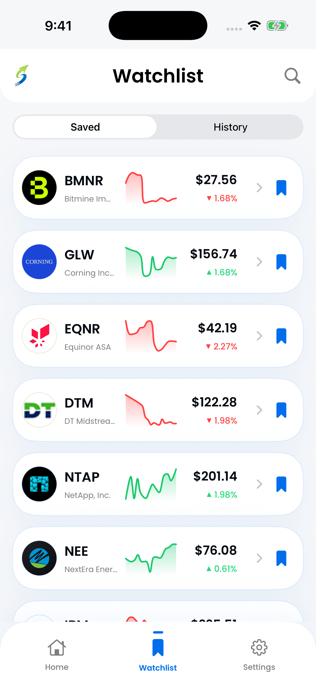

## A list for your attention

A stock watchlist is a collection of companies or securities you want to follow. Adding a ticker does not buy shares, commit money, or express a recommendation. It simply gives you an easier way to revisit something that caught your interest.

A portfolio records investments you actually hold. The same ticker can appear in both, but the jobs are different. Researching a possible idea and monitoring an existing financial exposure should not be confused.

## Give each addition a reason

A useful watchlist starts with a question. Perhaps you want to understand a subscription business, compare two suppliers, or follow a company's explanation of changing margins.

You do not need a large list. Add only as many companies as you can realistically revisit. A short list with clear questions is often more useful than a long list collected from headlines.

| Research reason          | Follow-up question                                      |
| ------------------------ | ------------------------------------------------------- |
| An interesting product   | How important is this product to the overall business?  |
| Revenue growth           | Is profitability moving in the same direction?          |
| An unfamiliar competitor | Where does it actually overlap with the company I know? |
| A surprising price move  | Did the business change, or only expectations?          |

_A watchlist is a place to revisit research questions. Stocker app screenshot; example data is historical._

## Separate observation from action

A daily price change can draw attention without changing your understanding of a business. Before reacting, identify what new evidence you have. A price movement and a new financial report are different kinds of information.

You can remove a company from your research list because your question has been answered or your interests changed. That is organization, not a trading decision.

If you also own a company, use appropriate portfolio records for position size, cost basis and performance. A simple watchlist should not be mistaken for a complete accounting system.

## Build a small routine

When you revisit a company, read the question you originally saved. Find one piece of evidence that helps answer it. Record its source and date, and decide what would be worth checking next.

Our [research worksheet](/tools/research-template/) provides space for that context. It is a separate spreadsheet, not an automatic import or synchronization feature in Stocker.

## How Stocker fits

Stocker connects discovery with a saved list: browse companies, open the information that interests you, and save the ones you want to revisit. You can also search by company name or ticker.

If your main need is a simple built-in iPhone watchlist, [Apple Stocks may be enough](/compare/apple-stocks-vs-stocker/). If you want a swipe-based way to find companies to research, Stocker offers a different starting point. Neither saving a ticker nor installing a research app replaces an investment decision process.
