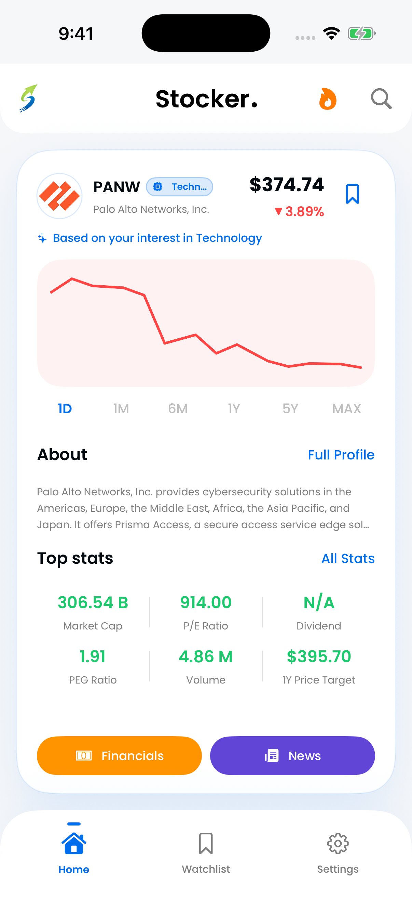

## Start with the job you need done

Yahoo Finance brings together a broad range of finance information, with portfolio and watchlist tools. Stocker is a focused iPhone and iPad app for discovering companies, exploring their information and keeping a saved list.

If you need a comprehensive market destination, breadth may matter most. If you want an approachable way to discover a company you do not already follow, the starting experience can matter more than the longest feature list.

## Compare the workflows

| Research task                   | Yahoo Finance                                      | Stocker                                                  |
| ------------------------------- | -------------------------------------------------- | -------------------------------------------------------- |
| Follow known tickers            | Watchlists within a broader finance platform       | Saved companies and direct company/ticker search         |
| Explore unfamiliar companies    | Multiple market and information entry points       | Swipe-based discovery shaped by interests and activity   |
| Organize holdings               | Portfolio tools are part of its published offering | Focus is discovery and a saved research list             |
| Investigate company information | Company and market information in a broad platform | Profiles, financials, charts and related news in the app |

The table describes the role of each product rather than promising identical coverage. Check current feature availability, region and plan requirements on the original product pages.

_Stocker’s discovery workflow starts with a company card. Screenshot shows historical example data._

## Breadth can be useful

A broad platform can reduce the number of places you visit for market context. It can also bring more navigation and information than you need for a short research session. Whether that feels helpful or distracting depends on the task.

Try naming your next action before opening an app: find a new business, read results, check a known company or review holdings. That makes it easier to judge whether a product helps you finish the job.

## Where Stocker is more focused

Stocker connects the discovery step with a saved watchlist. You can encounter a company, open its information and keep it for later. It does not execute trades, and this comparison does not claim portfolio-accounting or brokerage-sync features for it.

Its Premium offering adds features described in the current store listing. Prices and eligible trials are shown before purchase. A tool should be worth its cost for the task you actually use, not because it offers a large number of features you never open.

## A useful comparison exercise

Pick one company you already know and one you have never researched. In each product, try finding the business description, the reporting period behind a financial metric, and the original source you would use to verify it.

Then ask whether you can return to that company easily. If you need detailed holdings records, evaluate the portfolio workflow separately from the watchlist. A [watchlist and a portfolio](/learn/stock-watchlist/) answer different questions.

There is no universal winner here. Match the product to the part of your research process that needs help, and use company filings to verify material facts.
